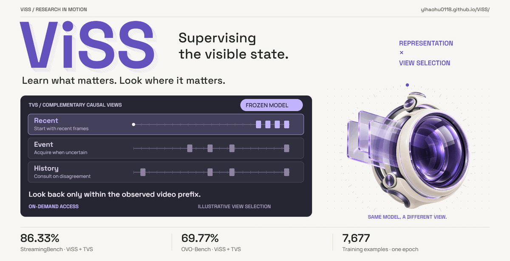
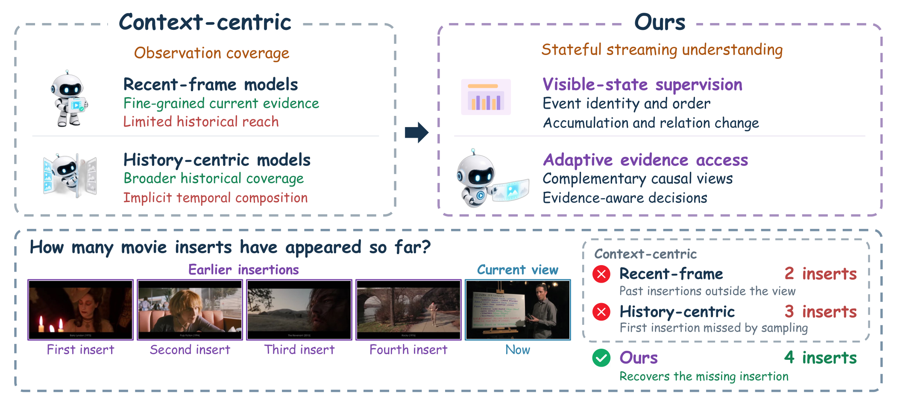

<div align="center">

<a href="https://yihaohu0118.github.io/ViSS/"></a>

# ViSS
### Supervising the Visible State: Separating Representation from View Selection in Streaming Video

Yihao Hu*, Pan Wang*, Yitong Lin*, Zhihao Wen†, Deyuan Liu, Hang Wang,<br>
Mingda WAN, Yiwen Zhao, Yutong Li, Yuchen Mao, Tao Lin†

<sup>* Equal contribution. † Corresponding author.</sup>

[**Project Homepage**](https://yihaohu0118.github.io/ViSS/) · [**Paper**](https://yihaohu0118.github.io/ViSS/assets/ViSS.pdf) · [**Code**](https://github.com/yihaohu0118/ViSS)

[Overview](#overview) · [Codebase](#codebase) · [Quick start](#quick-start) ·
[Models and data](#models-and-data) · [Training](docs/TRAINING.md) ·
[Evaluation](docs/EVALUATION.md) · [Citation](#citation)

</div>

<p align="center"><sub>Conceptual method animation · <a href="site/assets/brand/cover.png">Static poster</a> · <a href="https://yihaohu0118.github.io/ViSS/assets/brand/cover.mp4">12-second video</a> · <a href="https://yihaohu0118.github.io/ViSS/#demo">Interactive paper case</a></sub></p>


<p align="center"></p>

## Overview

**Visible-State Supervision (ViSS)** trains a vision–language model on
source-grounded questions about event identity, order, accumulation,
relation changes, and whether the visible evidence is sufficient.

**Test-Time Causal View Search (TVS)** keeps the trained model fixed and
acquires complementary causal views. It starts with recent frames, requests
an event view when needed, and consults compact history on disagreement.
Acquisition and answer commitment use separately calibrated thresholds.

This release provides data construction, training, inference, policy replay,
and scoring code. It contains no saved benchmark scores, prediction outputs,
or training logs. Scoring utilities and synthetic unit tests are included.

## Codebase

| Directory | Purpose | Guide |
| --- | --- | --- |
| `data_pipeline/` | Build source-grounded probes and matched generic controls | [Training](docs/TRAINING.md) |
| `experiments/` | Train the model, generate causal-view proposals, and apply TVS | [Evaluation](docs/EVALUATION.md) |
| `viss_core/` | Record validation, media handling, and benchmark adapters | [Data preparation](docs/DATA.md) |
| `scripts/` | Evaluation launchers, shard merging, and official scoring | [Evaluation](docs/EVALUATION.md) |
| `configs/` | Evaluation protocol and DeepSpeed configuration | [Installation](docs/INSTALL.md) |
| `tests/` | CPU checks of data contracts, sampling, loss masks, and view policies | [Quick start](#quick-start) |

The repository contains no internal training manifests, run records, data
inventories, calibration outputs, or file identities from company experiments.
The evaluation configuration is a public template; each user binds it to
their own inputs. See [Data preparation](docs/DATA.md).

## Quick start

Clone the repository, then run the commands from its root.

```bash
git clone https://github.com/yihaohu0118/ViSS.git
cd ViSS
```

### Install and check the source

```bash
python -m venv .venv
source .venv/bin/activate
python -m pip install --upgrade pip
python -m pip install -e ".[test]"
python -m pytest -q tests
```

The unit tests use synthetic inputs and do not download model weights or
benchmark media. GPU inference and training require the additional setup in
[Installation](docs/INSTALL.md).

### Generate predictions and score separately

After preparing your model, annotations, query exports, media, and
[local evaluation protocol](docs/EVALUATION.md#1-generate-recent-view-proposals):

```bash
python -m experiments.evaluate_qwen3vl_recent4_full \
  --benchmark streamingbench \
  --annotation data/streamingbench/annotations.json \
  --samples data/streamingbench/queries.jsonl \
  --video-root data/streamingbench/videos \
  --model checkpoints/viss \
  --processor checkpoints/viss/locked_processor \
  --protocol configs/evaluation/recent4_full_v1.json \
  --frame-policy recent4 \
  --visual-input-mode image-list \
  --record-choice-confidence \
  --output outputs/streamingbench_recent.json
```

The paths above are placeholders for separately prepared assets. Bind the
processor and query exports used in your evaluation before running inference.
The [evaluation guide](docs/EVALUATION.md) explains model
identity, TVS inputs, official scorers, and full-population checks.

## Models and data

| Resource | Included in this release? | Preparation |
| --- | --- | --- |
| Source code, tests, and protocol | Yes | This repository |
| Qwen3-VL-8B-Instruct initialization | No | Obtain the official model |
| Trained ViSS weights and locked processor | No | Obtain separately or train ViSS |
| Accepted training records and media | No | Follow [data preparation](docs/DATA.md) |
| Benchmark annotations, videos, and official scorers | No | Obtain from the benchmark owners |
| TVS calibration and model-identity artifacts | No | Supply artifacts matching your evaluation |

No public download endpoint for ViSS-specific weights or training records is
asserted by this source package.

## Training

The paper recipe is a fresh one-epoch run from Qwen3-VL-8B-Instruct.
It freezes the vision tower and updates the language model and multimodal
projector. [Training](docs/TRAINING.md) gives the two-GPU command and explains
the required sealed training release.

Some serialized records retain `streameva.*` schema identifiers. These are
record-format identifiers; the corresponding implementation in this release
is under `viss_core/`.

## License and acknowledgements

The project code uses the repository's [Apache-2.0 license](LICENSE).
Third-party software, media, models, and benchmark assets retain their
respective terms; see [NOTICE](NOTICE).

We acknowledge Qwen3-VL, StreamingBench, OVO-Bench, and SimpleStream.
The documentation organization follows the separation of setup, inference,
and evaluation used in [OneStreamer](https://github.com/MCG-NJU/OneStreamer).

## Citation

```bibtex
@misc{hu2026viss,
  title={Supervising the Visible State: Separating Representation from View Selection in Streaming Video},
  author={Yihao Hu and Pan Wang and Yitong Lin and Zhihao Wen and Deyuan Liu and Hang Wang and Mingda Wan and Yiwen Zhao and Yutong Li and Yuchen Mao and Tao Lin},
  year={2026},
  note={Manuscript},
  url={https://yihaohu0118.github.io/ViSS/}
}
```
